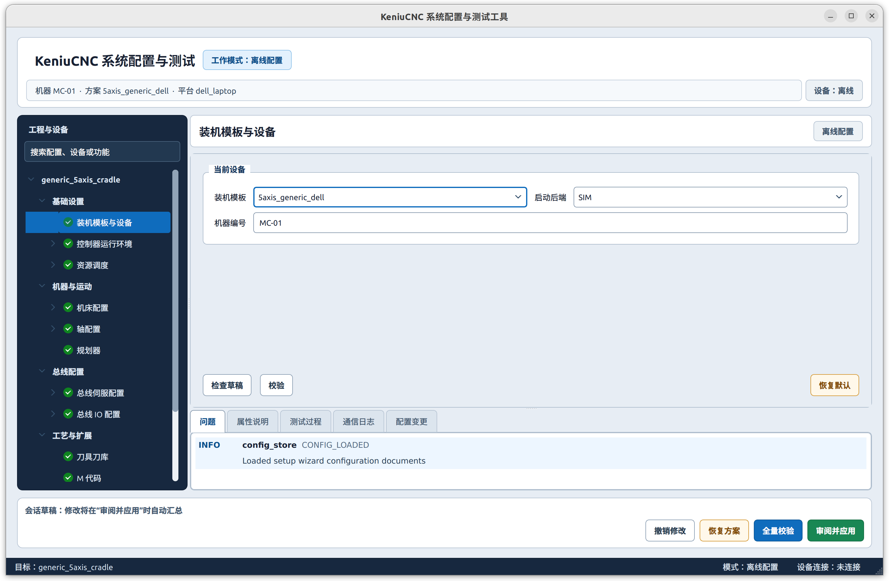
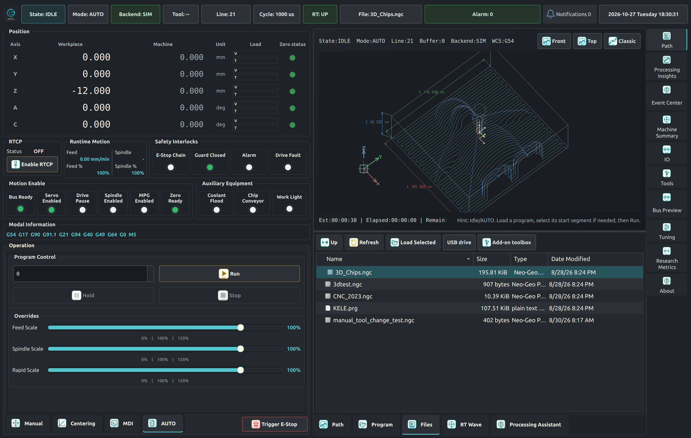
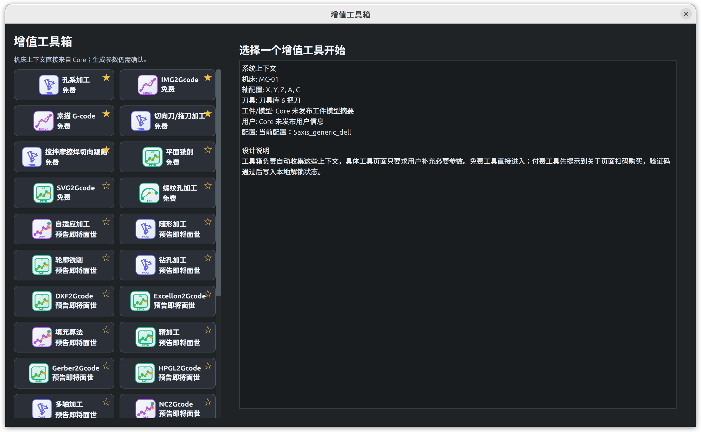

# Omni CNC

欢迎数控、自动化和 DIY 爱好者体验与交流！

Omni CNC 是面向数控学习、仿真和研究的控制软件。本仓库用于发布
Debian / Ubuntu DEB 安装包、版本说明和使用指引，用户无需自行编译。
可下载的安装包、支持平台及已知问题，以对应版本的发布说明为准。

> [!WARNING]
> **当前项目处于开发阶段，仅供学习、研究和 SIM 仿真，严禁连接实机，严禁用于实际加工或生产。**
>
> 软件尚未完成实机安全与可靠性验证，可能存在控制异常、程序错误和数据丢失等问题。
> 请保持与真实机床、伺服驱动、主轴及危险输出设备物理断开，不要执行实机点动、回零、试切或加工。
> **违反上述限制擅自使用，造成的人身伤害、设备损坏、财产损失、数据丢失及其他后果，由使用者自行承担。**
> 仿真正常、配置校验通过或周期抖动达到建议值，均不代表可以连接实机。

## 功能概览

当前开发版本可在 SIM 模式下体验以下功能，具体支持范围以对应发布版本为准。

| 功能 | 说明 |
| --- | --- |
| 程序与轨迹 | G-code 程序加载、轨迹预览、仿真执行和运行状态显示 |
| 多轴仿真 | 多轴运动、运动学配置与轨迹规划，包含五轴相关功能 |
| 操作界面 | 本地 Qt 界面与 Web 界面，显示坐标、程序、报警和设备状态 |
| 系统配置 | 图形化配置向导，用于选择平台、机型及配置轴、IO 等参数 |
| 刀具管理 | 刀具配置、使用记录与寿命信息 |
| 监视与诊断 | 运行监视、报警、系统事件和操作记录 |
| CAM 辅助编程 | 端面、孔加工、螺纹孔、图像/草图/SVG 转程序、切向切割和搅拌摩擦焊切向跟随等模块 |

G-code 指令支持范围、CAM 可用模块及各功能限制，请查看对应版本说明。

## 界面截图

以下为开发版本的界面示例，布局、名称和可用功能以对应发布版本为准。

### 初始化与系统配置

选择装机模板、平台与 SIM 后端，查看配置校验结果。



### Qt 操作界面

本地界面集中显示坐标、运行状态、程序文件和三维轨迹预览。图中使用 SIM 后端。



### CAM 工具箱

从工具箱选择辅助编程模块。截图中标为“预告即将面世”的项目尚未开放，实际可用模块以发布说明为准。



### Web 操作界面

通过浏览器查看坐标、任务摘要和报警，并使用相应操作入口。图中执行后端为 SIM。
本机默认地址为 [http://127.0.0.1:8080](http://127.0.0.1:8080)，其他设备访问方式见下方“Web 访问”一节。


## 硬件要求

| 项目 | 要求或建议 |
| --- | --- |
| CPU 架构 | 64 位 x86（`amd64`）或 64 位 ARM（`arm64`），须有匹配的安装包 |
| x86 CPU | 当前通用 x86 配置要求至少 4 个逻辑 CPU |
| ARM 平台 | 已有 RK3588 / Orange Pi 5 Plus 平台配置，需使用匹配板卡的系统镜像与安装包 |
| 内存 | 体验配置参考 8 GB；复杂预览、大程序或视觉处理需要预留更多内存 |
| 存储 | 建议使用 SSD，预留约 20 GB 可用空间用于软件、版本副本、程序和日志 |
| 显示 | Linux 图形桌面、可用的 Qt / OpenGL 驱动；建议分辨率 1920 × 1080 |
| 输入设备 | 鼠标和键盘；触摸屏兼容性需按设备确认 |

内存与存储数值是配置参考，尚未作为实测最低配置发布。
CPU 型号和核心数量不能单独保证周期抖动表现。当前体验不需要连接真实机床或总线从站。

## 系统与依赖要求

### 系统选择

**推荐先安装 LinuxCNC 官方 PREEMPT-RT 镜像系统，再安装 Omni CNC。**

- [LinuxCNC 官方下载页](https://linuxcnc.org/downloads/)
- [LinuxCNC 官方安装文档](https://linuxcnc.org/docs/html/getting-started/getting-linuxcnc.html)

选择与硬件及 Omni CNC 安装包匹配的镜像，按官方说明安装到磁盘后进入图形桌面。
安装系统前请备份磁盘上的个人资料。这里只推荐完整镜像系统，单独安装 LinuxCNC 软件包不等于安装镜像系统。

也可使用自行准备的兼容 Debian / Ubuntu 系统，但环境适配和周期抖动问题需自行解决。
**建议实际负载下的周期抖动小于 50 μs（微秒）**，评估时关注最大观测值。
LinuxCNC 镜像不能保证所有硬件都达到该目标，此数值也不是实机安全验收标准。

遇到安装或运行问题，请通过本仓库 Issues 反馈。

### 依赖安装

- **IgH 必须自行安装，SIM 模式也不例外。** 在安装 Omni CNC 前，准备与系统内核、
  CPU 架构及平台匹配的 IgH EtherCAT Master 和相关依赖，包括
  `ethercat-master`、`libethercat-dev`，或提供相应工具、头文件和库的等效安装。
- **除 IgH 外的其他运行依赖，由 DEB 安装流程自动检测并安装。**
  请保持网络连接和对应系统的 APT 软件源可用。
- DEB 不自动安装 IgH，也不安装实时内核、绑定网卡或配置从站。
  安装 IgH 依赖不需要连接真实总线设备，当前版本仍严禁连接实机。

## 安装步骤

### 1. 确认系统与 IgH 已准备好

先按上面的说明安装系统和 IgH。ARM 板卡需要使用匹配板卡的镜像，
不能使用 x86 PC 的 ISO，也不能直接套用其他 ARM 板卡的镜像。

### 2. 选择安装包

从[本仓库](https://gitee.com/zhangqiangsam/omni-cnc)的发布附件或版本目录下载 DEB，
并阅读同版本发布说明。请选择同时匹配以下信息的安装包：

- 发行版及版本，例如 Debian 12、Debian 13 或对应的 Ubuntu 版本。
- CPU 架构：`amd64` 或 `arm64`。
- 硬件平台：`generic` 或发布说明指定的平台。

包文件名一般为：

```text
keniucnc_<版本>_<发行版>_<硬件平台>_<架构>.deb
```

发行版版本以镜像实际使用的系统为准，不是 LinuxCNC 应用的版本号。
不同发行版、系统版本或架构的包不能混用。平台专用包可能依赖特定 CPU 指令集，
不要仅因架构相同就安装到其他设备。

如需核对本机系统与架构，可执行：

```bash
cat /etc/os-release
dpkg --print-architecture
```

### 3. 检查并安装 DEB

在安装包所在目录打开终端，将文件名替换为实际下载的文件名：

```bash
DEB_FILE='./实际下载的安装包文件名.deb'
dpkg-deb --field "$DEB_FILE" Package Version Architecture Depends
sha256sum "$DEB_FILE"
```

核对包名为 `keniucnc`，版本和架构与下载目标一致；如发布说明提供 SHA-256 校验值，
请与计算结果比对。确认后，在同一终端执行：

```bash
sudo apt update
sudo apt install "$DEB_FILE"
```

安装流程会处理除 IgH 外的其他运行依赖。若出现依赖无法满足或其他错误，
请保留完整报错并提交 Issue，不要强制忽略依赖。

### 4. 启动并体验仿真

产品名为 Omni CNC，当前安装包、命令和桌面入口仍使用 `keniucnc` / **KeniuCNC** 名称。

1. 从桌面应用菜单打开 **KeniuCNC 系统配置**，确认平台、机型与 **SIM** 运行模式。
   工厂默认模板为通用 x86 五轴机型；ARM 设备尤其需要核对平台选择。
2. 应用配置并退出向导后，从菜单主动打开 **KeniuCNC**。配置完成不会自动启动主程序。
3. 确认处于 SIM 模式，再打开示例程序，体验轨迹预览、坐标、报警和仿真操作。

若启动时自动进入初始化向导，同样应先完成配置，再主动打开主程序。
请使用当前登录的普通桌面账户，**不要用 `sudo` 启动界面**。
也可在图形桌面的终端执行 `keniucnc-launcher`。

用户程序目录为 `~/keniucnc/programs`，首次启动会补充缺失的示例程序，不覆盖已有同名文件。
安装包包含桌面会话自启动入口；登录桌面后可能自动启动应用，可在桌面的自启动设置中管理。

## Web 访问

先从桌面启动 **KeniuCNC**，等待应用与 Web 服务启动后，再在浏览器中打开：

| 访问位置 | 地址 |
| --- | --- |
| 运行 Omni CNC 的电脑本机 | [http://127.0.0.1:8080](http://127.0.0.1:8080) |
| 同一电脑的另一种写法 | [http://localhost:8080](http://localhost:8080) |
| 同一局域网中的其他电脑或平板 | `http://运行 Omni CNC 的电脑IP:8080` |

例如，运行 Omni CNC 的电脑 IP 为 `192.168.1.100` 时，其他设备访问
`http://192.168.1.100:8080`。这是地址示例，请替换为你自己的 IP。
可在运行 Omni CNC 的电脑上执行以下命令查看 IP，选择与访问设备处于同一局域网的地址：

```bash
hostname -I
```

`127.0.0.1` 和 `localhost` 始终指向浏览器所在的设备，不能用来访问另一台电脑。
默认 Web 端口为 **8080**；若平台配置已调整端口，请使用实际端口。
加工台页面可直接通过 `http://运行 Omni CNC 的电脑IP:8080/#control` 打开。

局域网访问需要 Web 服务监听对应网络地址，且网络与防火墙允许访问该端口。
仅限可信局域网使用，不要将控制接口直接暴露到互联网；所有体验仍须保持 SIM 模式。
若无法访问，请先确认主程序已启动，核对 IP、端口及网络连通性，并通过
[Issues](https://gitee.com/zhangqiangsam/omni-cnc/issues)反馈报错或浏览器截图。

项目下载与版本说明见[仓库首页](https://gitee.com/zhangqiangsam/omni-cnc)，
安装和使用问题统一提交到 [Issues](https://gitee.com/zhangqiangsam/omni-cnc/issues)。

## 升级与备份

升级前退出仿真任务和应用，备份以下数据：

| 路径 | 内容 |
| --- | --- |
| `/etc/keniucnc` | 系统与机型配置 |
| `/var/lib/keniucnc` | 持久状态、刀具与作业相关数据 |
| `/var/log/keniucnc` | 日志、系统事件及操作记录 |
| `~/keniucnc/programs` | 当前用户的程序，多用户环境需分别备份 |

下载匹配的新包后，按上述安装步骤设置新包路径并执行 `sudo apt install "$DEB_FILE"`。
升级后主动重新启动，核对配置并继续在 SIM 模式下使用。

## 卸载步骤

退出应用并备份需要保留的数据后，选择以下一种方式。

**普通卸载：**

```bash
sudo apt remove keniucnc
```

移除当前包和启动入口，保留发布副本、用户数据及缓存。

**清除软件及发布副本：**

```bash
sudo apt purge keniucnc
```

在普通卸载的基础上，删除 `/opt/keniucnc/current`、`/opt/keniucnc/releases`
和 `/var/cache/keniucnc`。

两种方式都保留 `/etc/keniucnc`、`/var/lib/keniucnc`、`/var/log/keniucnc`
以及各用户的 `~/keniucnc/programs`。**`purge` 不会删除全部用户数据。**
卸载 Omni CNC 不会一并卸载 LinuxCNC、实时内核或单独安装的 IgH。

## 问题反馈

安装失败、无法启动、界面异常或其他问题，请提交到：

**[Omni CNC Issues](https://gitee.com/zhangqiangsam/omni-cnc/issues)**

为便于定位，请尽量附上：

- 软件版本和完整安装包名。
- 镜像来源、系统版本、CPU 架构、内存和内核版本。
- 复现步骤、完整报错及相关日志。
- 涉及周期抖动时，附测量工具、负载条件和测量结果。

可使用以下命令查看已安装版本、内核和关键日志：

```bash
dpkg-query -W keniucnc
uname -r
journalctl -t keniucnc -b --no-pager
journalctl -t keniucnc-launcher -b --no-pager
```

应用日志位于 `/var/log/keniucnc`。公开提交日志前，请删除密钥、个人资料和设备敏感信息。

## 许可说明

本仓库公开提供下载与交流，公开访问不等于采用开源许可证或授予任意再分发权。
软件及第三方组件的使用、复制和分发，以对应版本的许可协议与版权声明为准。
